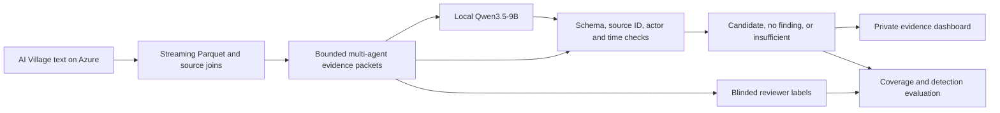

# SwarmGuard: evidence-grounded swarm incident investigation

Status on 2026-10-02: **SwarmGuard has a working Azure-local investigation pipeline.** The provisional decision model is frozen Qwen3.5-9B in fast mode, selected after comparing smaller local models. It returns structured findings tied to source IDs; deterministic checks verify those references before a private evidence dashboard displays them. No inference API calls have been made. The repository remains local, per the owner's instruction.

The investigation targets coordinated constraint violations, contradicted claims that another agent explicitly relies on, and unauthorized goal substitution. Qwen3.5-9B matched all eight authored development cases in 146.3 seconds with four CPU workers. This small diagnostic set is not held out and does not establish natural-data accuracy. Ordinary errors, shared URLs and temporal proximity are insufficient evidence. A model result is a review candidate, not proof of intent. Human reference labels are still required.

The Azure VM has 64 vCPUs, about 504 GiB RAM, and a verified 866 GiB scratch mount. The pinned text export contains 2.51 million computer-use turns and 183,485 chat messages. The existing pipeline links 100,353 of 100,354 sent-chat actions, with zero source-text mismatches, tied nearest matches or reused chat records in the new audit. This is provenance integrity, not measured detection accuracy. No dataset or model weights have been downloaded to the Mac.

Start with the [local runbook](docs/local-runbook.md), [model comparison and measurements](docs/local-decision-models.md), and [local configuration](config/local.toml). The [earlier frontier design](docs/frontier-research.md) and [prospective evaluation](docs/frontier-evaluation.md) remain references; their proposed API experiments have not run. Local inference stays on Azure and needs no OpenAI key. Natural-data accuracy remains unmeasured until source cases receive reference review.

The [current submission draft](docs/swarmguard-submission-draft.md) and [aggregate benchmark record](benchmarks/2026-10-02/summary.json) describe completed work and limits. The first eight real cases took 374.5 seconds: four completed no-finding outputs and four timeouts, with all eight routed to insufficient because of incomplete history. Expanded retrieval now includes bounded peer actions after the reference. No real incident is confirmed.

Run the authored end-to-end pilot **on Azure**:

```sh
cd /home/azureuser/ai-swarm/project
/home/azureuser/ai-swarm/.venv/bin/python scripts/run_swarm_review.py --synthetic \
  --model-profile 9b --workers 4 --threads 8 \
  --output-dir /home/azureuser/ai-swarm/restricted/swarmguard-authored-run
```

The output contains a self-contained HTML dashboard, deterministic review routes, checkpoint and packet hashes, and CPU/RAM/disk/runtime measurements. AgentDoG remains a broad safety baseline; DeBERTa NLI is an optional helper for independently verified result/claim mappings. Neither gates or overrides the contextual judge. Both exposed important failure cases in testing. All model inference runs on Azure.



The commands and links below document the **historical Laya baseline and reusable ingestion infrastructure**. Laya is no longer part of the selected detector. Do not rerun its inference to run the new pipeline.

After mounting scratch, creating the pinned environment, and completing Hugging Face login **on the VM**, run:

```sh
bash /home/azureuser/ai-swarm/project/scripts/run_pipeline.sh
/home/azureuser/ai-swarm/.venv/bin/python /home/azureuser/ai-swarm/project/scripts/investigate.py check
/home/azureuser/ai-swarm/.venv/bin/python /home/azureuser/ai-swarm/project/scripts/investigate.py review
```

The pipeline fetches only named text tables, never the 177 GB screenshot corpus. The `review` command inspects and labels the next blinded case in an authorized VM terminal. `case POSITION` displays the raw source trail and Laya annotation on the VM; `review` hides the annotation and rank. Do not pipe raw case output back to a local machine or into Git. The [VM runbook](docs/vm-runbook.md) gives exact setup and recovery steps.

- [Assessment A–E](docs/reconnaissance.md): event, dataset metadata, prior work, candidate approaches, evaluation, and implementation gates.
- [Measured dataset audit and direction decision](docs/dataset-audit.md): actual rows, links, modalities, resource costs, and caveats.
- [Pre-registered review policy](docs/label-policy.md): completed-claim and evidence labels, sampling, and honest limits.
- [VM runbook](docs/vm-runbook.md): measured environment, scratch setup, and data-access procedure.
- [VM-only diagnostic](scripts/vm_preflight.py): credential-safe collector already run on the VM.
- [Laya CPU smoke benchmark](scripts/laya_cpu_smoke.py): bounded synthetic inference with runtime and resource measurements.
- [VM environment bootstrap](scripts/bootstrap_vm.sh): recreate the pinned Python environment on the mounted VM scratch setup.
- [Bounded JSONL probe](scripts/probe_jsonl.py): inspect key names and value types on the VM without printing record values.
- [Pinned schema fetcher](scripts/fetch_dataset_docs.py): download only three small documentation files using the VM's existing Hugging Face login.
- [Explicit text-table fetcher](scripts/fetch_text_files.py): plan and download selected pinned `.jsonl.gz` files to VM scratch with space checks and persistent hashes.
- [Aggregate join audit](scripts/audit_core_tables.py) and [turn/memory audit](scripts/audit_turns_memories.py): measured counts, links, modalities, and resource use.
- [Streaming Parquet projection](scripts/build_projected_tables.py): retain only evidence fields needed for the investigator on VM scratch.
- [Send-to-chat provenance join](scripts/link_sent_messages.py) and [bounded evidence windows](scripts/build_evidence_windows.py): link public claims to preceding tool actions.
- [Laya claim pilot](scripts/laya_claim_pilot.py): measured frozen inference and option-order check on 300 VM-side messages.
- [Laya binary and focused-clause pilots](scripts/laya_binary_pilot.py), [laya_clause_pilot.py](scripts/laya_clause_pilot.py): compare schemas and input construction before scaling inference.
- [Review lead ranking](scripts/rank_review_leads.py): transparent aggregate triage; scores are not misalignment probabilities.
- [VM pipeline runner](scripts/run_pipeline.sh), [blinded review queue](scripts/prepare_review_queue.py), [Laya annotations](scripts/annotate_review_queue.py), [interactive investigator](scripts/investigate.py), and [review metrics](scripts/summarize_reviews.py).
- [VM-local derived checkpoint](scripts/checkpoint_derived.py): save/restore hashed Parquet on the VM's persistent disk before deallocation.
- [Public-safe synthetic demo](scripts/demo_synthetic.py) and [demo walkthrough](docs/demo.md): show real Laya inference without exposing AI Village records.
- [Aggregate report renderer](scripts/render_aggregate_report.py) and [submission write-up](docs/submission-writeup.md).
- [Exact VM package versions](requirements.lock.txt): initial lockfile; install the CPU PyTorch wheel from its CPU index before applying it.
- [Frozen experiment configuration](config/experiment.toml): dataset/model revisions, retrieval bounds, review allocation, and CPU settings.
- [Research and experiment status](docs/experiment-log.md): facts, unknowns, and execution status.

The Mac is a control and documentation machine. Corpus access, extraction, indexing, model downloads, inference, and performance monitoring run on the Azure VM `hackathon`. Only code, documentation, and reviewed aggregate reports belong in this repository.

The dataset permits research and analysis, with written permission required for training or fine-tuning. No training or fine-tuning is planned. Historical package/model revisions are pinned in the VM runbook and lockfile; frontier request settings and checked pricing are in `config/frontier.toml`. Human-adjudicated detection quality is not yet measured.

Dataset citation: AI Digest, “AI Village dataset,” 2026. [Dataset card and research terms](https://huggingface.co/datasets/aidigestorg/ai-village).
